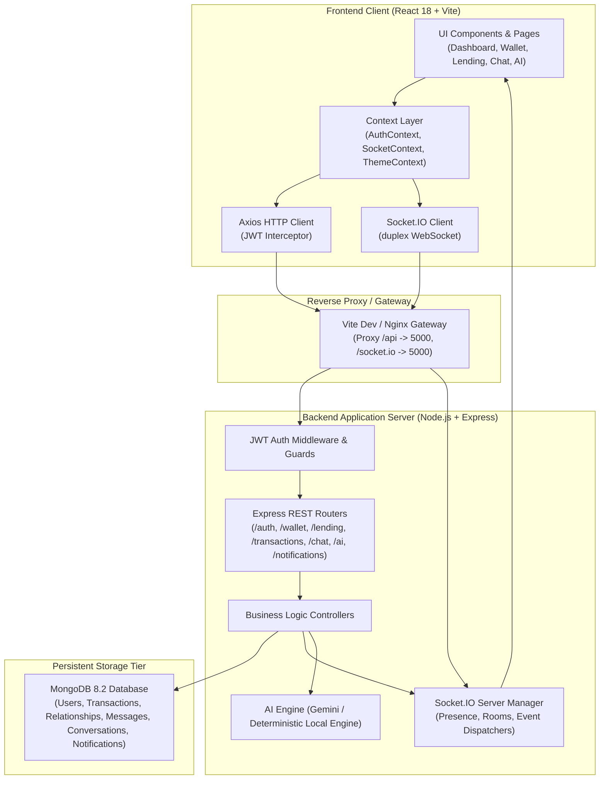
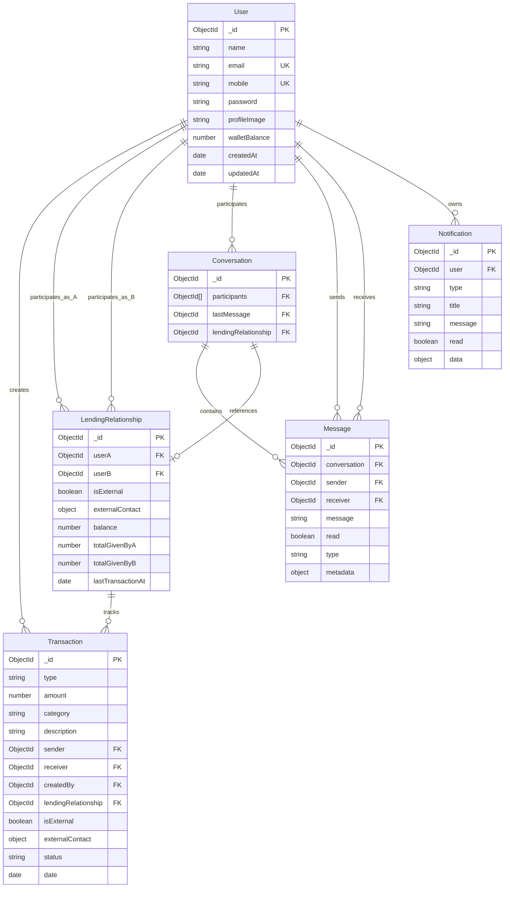
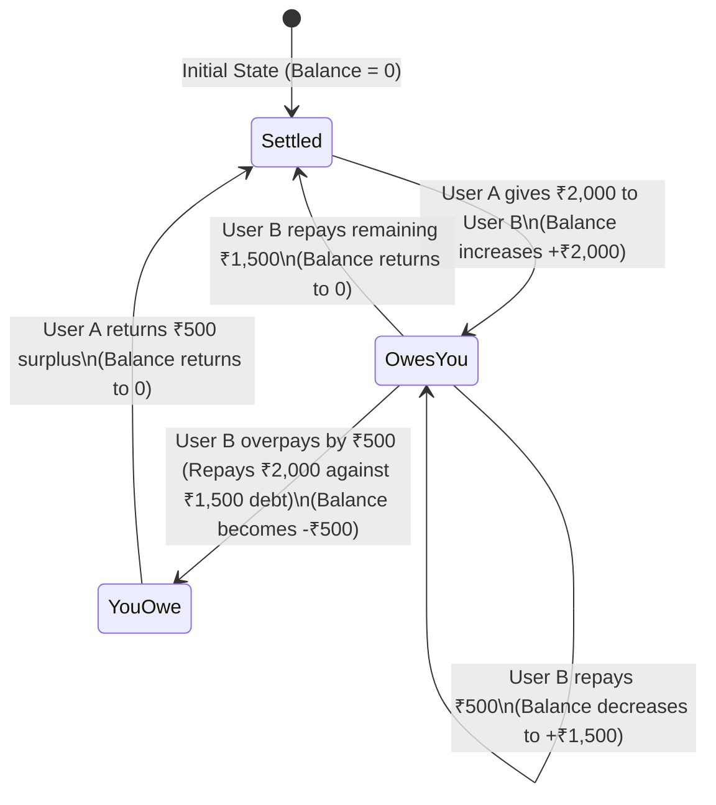
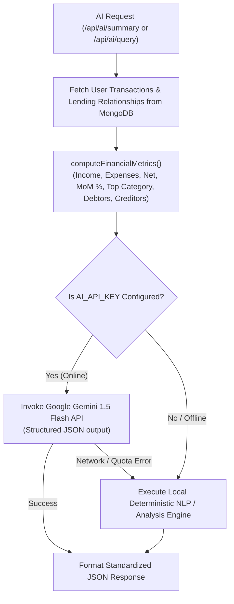

# PocketGuard — Comprehensive Technical Architecture & Engineering Specification

**Document Version:** 1.0.0  
**Status:** Approved & Implemented  
**Date:** September 2026  
**Author:** Antigravity Engineering Team  
**Repository:** `d:/WalletGuard`  

---

## Table of Contents

1. [Executive Summary & System Objectives](#1-executive-summary--system-objectives)
2. [End-to-End System Architecture](#2-end-to-end-system-architecture)
3. [Database Architecture & Data Models](#3-database-architecture--data-models)
4. [Two-Sided Lending Synchronization Engine](#4-two-sided-lending-synchronization-engine)
5. [Real-Time WebSocket Protocol (Socket.IO)](#5-real-time-websocket-protocol-socketio)
6. [In-Chat Financial Relationship Synchronization](#6-in-chat-financial-relationship-synchronization)
7. [AI Intelligence & Analytical Fallback Engine](#7-ai-intelligence--analytical-fallback-engine)
8. [Security & Tenancy Enforcement](#8-security--tenancy-enforcement)
9. [Complete REST API Specification](#9-complete-rest-api-specification)
10. [Frontend Architecture & State Topology](#10-frontend-architecture--state-topology)
11. [Scalability, Deployment & Operational Guidelines](#11-scalability-deployment--operational-guidelines)

---

## 1. Executive Summary & System Objectives

**PocketGuard** is a full-stack financial technology platform engineered to bridge the gap between individual personal cash-flow management and bilateral peer-to-peer lending ledgers. 

### 1.1 Core Problems Addressed
* **Financial Ledger Fragmentation:** Traditional wallet trackers record personal expenditures but fail to track informal loans (*"I lent ₹2,000 to Rahul"*).
* **Asymmetrical Debt Tracking:** Traditional debt apps require both users to maintain separate, decoupled records, resulting in discrepancies, double-entry confusion, and forgotten loans.
* **Context Disconnect in Messaging:** Loan negotiations occur over standard messaging applications (WhatsApp, SMS), disconnected from the balance state.
* **Lack of Predictive Analysis:** Users often lack insight into pending receivables vs. upcoming personal expenditure commitments.

### 1.2 System Invariants & Non-Negotiables
1. **Mathematical Invariance:** For any registered pair $(U_A, U_B)$, the balance recorded by $U_A$ regarding $U_B$ must equal the negative of the balance recorded by $U_B$ regarding $U_A$ at all times:
   $$\text{Balance}(U_A, U_B) = - \text{Balance}(U_B, U_A)$$
2. **Atomic Consistency:** Financial state updates, transaction audit logs, and counterparty notifications execute in unified database operations.
3. **Zero Data Desynchronization:** Duplex WebSocket events update both users' graphical interfaces without requiring page reloads or polling.

---

## 2. End-to-End System Architecture



### 2.1 Communication Channels
* **Synchronous Channel (HTTP/1.1 REST):** Used for idempotent data retrieval, initial state hydration, user registration, and bulk querying.
* **Asynchronous Channel (WebSockets via Socket.IO):** Used for bi-directional peer-to-peer chat, real-time transaction event broadcasts, typing status notifications, and live presence detection.

---

## 3. Database Architecture & Data Models

The persistence layer is implemented in MongoDB with normalized relational links and compound indexing to optimize high-frequency queries.



### 3.1 Field-Level Data Dictionary

#### `User`
| Field | Type | Attributes | Description |
| :--- | :--- | :--- | :--- |
| `_id` | `ObjectId` | Primary Key | Canonical User Identifier |
| `name` | `String` | Required, Trimmed | Display name |
| `email` | `String` | Required, Unique, Lowercase | User email for credentials |
| `mobile` | `String` | Required, Unique, Trimmed | Unique phone number used for lending discovery |
| `password` | `String` | Required | Hashed bcrypt string (cost factor 10) |
| `profileImage` | `String` | Default string | Avatar image URL |
| `walletBalance` | `Number` | Default `0` | Cached personal wallet liquidity |

#### `LendingRelationship` (Single Source of Truth)
| Field | Type | Attributes | Description |
| :--- | :--- | :--- | :--- |
| `_id` | `ObjectId` | Primary Key | Canonical Relationship ID |
| `userA` | `ObjectId` | Required, Ref `User` | Lexicographically smaller User ID (or external owner) |
| `userB` | `ObjectId` | Optional, Ref `User` | Lexicographically larger User ID (null for external) |
| `isExternal` | `Boolean` | Default `false` | Distinguishes registered pairs from external contacts |
| `externalContact` | `Object` | `{ name, mobile }` | Unregistered contact profile details |
| `balance` | `Number` | Default `0` | Positive: $U_B$ owes $U_A$; Negative: $U_A$ owes $U_B$ |
| `totalGivenByA` | `Number` | Default `0` | Cumulative lifetime funds lent by User A |
| `totalGivenByB` | `Number` | Default `0` | Cumulative lifetime funds returned/lent by User B |
| `lastTransactionAt`| `Date` | Default `now` | Timestamp of latest ledger mutation |

---

## 4. Two-Sided Lending Synchronization Engine

### 4.1 Canonical Ordering & Invariant Guarantee
To prevent conflicting records (e.g. $U_1 \to U_2$ and $U_2 \to U_1$ having independent states), the backend mandates **Canonical User Ordering**:

$$\text{UserA} = \min(ID_1, ID_2), \quad \text{UserB} = \max(ID_1, ID_2)$$

This guarantees that a single database document represents the bilateral state between any two registered entities in PocketGuard.

### 4.2 Perspective Calculation Algorithm
When a user $U_X$ requests relationship details:
```javascript
const getPerspective = (userId) => {
  const isA = userA._id.toString() === userId.toString();
  
  // Balance convention:
  // Positive => Counterparty owes currentUser
  // Negative => CurrentUser owes counterparty
  const netBalance = isA ? this.balance : -this.balance;
  const totalGiven = isA ? this.totalGivenByA : this.totalGivenByB;
  const totalReceived = isA ? this.totalGivenByB : this.totalGivenByA;
  
  let status = 'settled';
  if (netBalance > 0) status = 'owes_you';
  else if (netBalance < 0) status = 'you_owe';

  return {
    counterparty: isA ? userB : userA,
    netBalance,
    totalGiven,
    totalReceived,
    status,
    lastTransactionAt
  };
};
```

### 4.3 State Transition Flow for Lending & Repayments



### 4.4 Handled Edge Cases
* **Overpayment Reconciliation:** When a borrower repays more than their current debt, `balance` transitions past zero into the opposite quadrant without throwing an error. The debtor cleanly becomes the creditor.
* **Self-Lending Prevention:** The controller explicitly blocks operations where `senderId === receiverId`.
* **Atomic Wallet Balances:** Every lending/borrowing transaction updates both users' wallet liquidity counters atomically via `$inc`.

---

## 5. Real-Time WebSocket Protocol (Socket.IO)

The WebSocket infrastructure operates under an authenticated handshake mechanism using JWTs.

### 5.1 Connection Lifecycle
1. **Handshake Authentication:** The client passes `token` in `socket.handshake.auth`.
2. **Session Identification:** The server decodes the token, loads the user record, and assigns `socket.user`.
3. **Room Allocation:**
   * Private Room: `socket.join("user_" + userId)` for private alerts, wallet updates, and notifications.
   * Active Conversation Room: `socket.join("conversation_" + conversationId)` when viewing a chat.
4. **Presence Broadcasting:** On connection/disconnection, `user:status` is broadcast to all active connections.

### 5.2 WebSocket Event Catalog

| Event Name | Direction | Payload Schema | Description |
| :--- | :--- | :--- | :--- |
| `users:online_list` | Server $\to$ Client | `string[]` (User IDs) | Hydrates initial online users set upon connect |
| `user:status` | Server $\to$ Client | `{ userId, status: 'online' \| 'offline' }` | Presence change notification |
| `conversation:join` | Client $\to$ Server | `conversationId` | Subscribes socket to conversation stream |
| `conversation:leave`| Client $\to$ Server | `conversationId` | Unsubscribes socket from conversation stream |
| `typing:start` | Client $\to$ Server | `{ conversationId, receiverId }` | Emits typing state to conversation/receiver |
| `typing:stop` | Client $\to$ Server | `{ conversationId, receiverId }` | Cancels typing state |
| `message:new` | Server $\to$ Client | `Message` Document | Transmits new live message to conversation room |
| `message:received` | Server $\to$ Client | `{ conversationId, message, sender }` | Pushes push-notification event to recipient |
| `wallet:update` | Server $\to$ Client | `{ walletBalance, amount }` | Signals client to refresh wallet balances |
| `lending:update` | Server $\to$ Client | `{ relationshipId }` | Signals client to refresh lending view |
| `transaction:new` | Server $\to$ Client | `Transaction` Document | Live transaction arrival alert |
| `notification:new` | Server $\to$ Client | `Notification` Document | Dispatches real-time notification alert |

---

## 6. In-Chat Financial Relationship Synchronization

A core differentiator of PocketGuard is the unified presentation of live financial status inside the active chat timeline.

```
┌────────────────────────────────────────────────────────────────────────┐
│ Rahul Sharma  ● Online                         +91 9876543211          │
├────────────────────────────────────────────────────────────────────────┤
│ 🛡️ LIVE SYNCHRONIZED FINANCIAL BALANCE                                 │
│ You gave: ₹5,000  •  Rahul returned: ₹2,000  •  Rahul owes you ₹3,000  │
│                                                                        │
│                      [+ Give Money]  [Receive Money]  [Settle Up]      │
├────────────────────────────────────────────────────────────────────────┤
│ [10:30 AM] Rahul: Hey Roshan, I got the laptop fixed.                  │
│ [10:32 AM] Roshan: Great, let me know when you can start repayment.   │
│                                                                        │
│ ┌────────────────────────────────────────────────────────────────────┐ │
│ │ 💸 Financial Update: Rahul Sharma recorded repayment of ₹2,000.    │ │
│ └────────────────────────────────────────────────────────────────────┘ │
│                                                                        │
│ [10:45 AM] Rahul: Just sent ₹2,000 via UPI 👍                          │
│ [10:46 AM] Roshan: Received it! PocketGuard shows ₹3,000 remaining.   │
├────────────────────────────────────────────────────────────────────────┤
│ Message Rahul Sharma...                                         [Send] │
└────────────────────────────────────────────────────────────────────────┘
```

When a user clicks **[+ Give Money]** or **[Settle Up]** inside the chat:
1. The transaction modal opens with the counterparty already populated.
2. The transaction is submitted via `/api/lending`.
3. The server commits the transaction and immediately broadcasts:
   * A `transaction_alert` message in the active conversation.
   * A `lending:update` event refreshing the top banner.
   * A `wallet:update` event updating both users' wallet counters.
4. Neither user needs to refresh the browser to observe the changes.

---

## 7. AI Intelligence & Analytical Fallback Engine

PocketGuard employs a modular, dual-engine approach to financial insights:



### 7.1 Data Protection & Privacy Guard
The system strictly sanitizes all user data prior to prompt synthesis:
* Passwords, emails, and phone numbers are excluded from context.
* Only computed aggregates (e.g. `thisMonthIncome`, `categoryExpenses`, `totalReceivable`) are passed.
* Financial outputs are strictly framed as retrospective analysis rather than speculative or fiduciary investment advice.

---

## 8. Security & Tenancy Enforcement

1. **Authentication:** Stateless JSON Web Tokens (JWT) signed with HMAC-SHA256 (`JWT_SECRET`), expiring in 30 days.
2. **Authorization Enforcement:** Every protected route passes through `protect` middleware. All database filters strictly scope by `req.user._id`:
   ```javascript
   const query = {
     $or: [{ createdBy: userId }, { sender: userId }, { receiver: userId }]
   };
   ```
3. **Password Security:**
   * Bcrypt hashing with automated salt generation.
   * `toJSON` prototype hook strips `password` from all serialized Mongoose objects.
4. **CORS Governance:** Strict Origin verification permitting only designated frontend endpoints (`http://localhost:5173`).

---

## 9. Complete REST API Specification

### Authentication (`/api/auth`)
* `POST /api/auth/register` — Create account (`name, email, mobile, password`).
* `POST /api/auth/login` — Authenticate (`identifier, password`).
* `GET  /api/auth/me` — Retrieve current authenticated profile.
* `PUT  /api/auth/profile` — Update display name and avatar image.
* `GET  /api/auth/users/search?query=...` — Search registered peers by name or mobile.

### Wallet & Personal Capital (`/api/wallet`)
* `GET  /api/wallet/dashboard` — Aggregated wallet balance, 6-month cash flow, category breakdown.
* `POST /api/wallet/adjust` — Manual adjustment (`amount, action: 'add'|'subtract'|'set', description`).

### Lending & Debt Synchronization (`/api/lending`)
* `GET  /api/lending` — Lending dashboard summary totals and contact lists.
* `POST /api/lending` — Log lending, borrowing, or repayment.
* `POST /api/lending/:id/repay` — Quick settlement endpoint.
* `GET  /api/lending/:id` — Specific bilateral transaction audit trail.

### General Transactions (`/api/transactions`)
* `GET    /api/transactions` — Query with filters (`type, category, startDate, endDate, search, sortBy, sortOrder, page, limit`).
* `POST   /api/transactions` — Create personal income/expense record.
* `DELETE /api/transactions/:id` — Delete transaction with liquidity rollback.

### Chat & Messaging (`/api/chat`)
* `GET  /api/chat/conversations` — Retrieve user's conversation threads with unread counts.
* `POST /api/chat/conversations` — Initialize or fetch conversation with counterparty.
* `GET  /api/chat/messages/:conversationId` — Fetch chat history and mark unread messages as read.
* `POST /api/chat/messages` — Send text message or system notification.

### AI Financial Engine (`/api/ai`)
* `GET  /api/ai/summary` — Generate executive summary and savings suggestions.
* `POST /api/ai/query` — Natural language assistant query processing.

### Notifications (`/api/notifications`)
* `GET    /api/notifications` — Fetch user notification feed.
* `PUT    /api/notifications/:id/read` — Mark notification as read.
* `PUT    /api/notifications/read-all` — Mark entire notification feed as read.
* `DELETE /api/notifications/clear` — Clear read notifications.

---

## 10. Frontend Architecture & State Topology

The React frontend utilizes an unopinionated Context API architecture:

```
[ App.jsx ]
   │
   ├── ThemeProvider (Dark / Light Theme DOM Management)
   │
   ├── AuthProvider (Session, JWT Storage, Current User Profile)
   │
   └── SocketProvider (WebSocket Connection, Real-time Subscriptions, Toast Alerts)
         │
         ├── MainLayout (Navbar, Desktop Sidebar, Mobile Nav, Modals)
         │     ├── DashboardPage
         │     ├── WalletPage
         │     ├── LendingPage
         │     ├── TransactionsPage
         │     ├── ChatPage
         │     ├── AiAnalysisPage
         │     └── ProfilePage
         │
         └── AuthLayout (Centered Brand Container)
               ├── LoginPage (with Quick-Demo autofill)
               └── RegisterPage
```

---

## 11. Scalability, Deployment & Operational Guidelines

### 11.1 Production Build
```bash
# Build optimized client bundles
npm --prefix client run build
```
The output directory `client/dist/` is statically served or routed through Nginx / CDN.

### 11.2 Horizontal Scaling with Redis
To scale the Node.js backend across multiple instances or containers:
1. Equip Socket.IO with the `@socket.io/redis-adapter`.
2. Connect all Express server instances to a shared Redis cluster to synchronize room broadcasts and presence across cluster nodes.

### 11.3 Database Indexing Recommendations
* `users`: `{ email: 1 }` (unique), `{ mobile: 1 }` (unique)
* `lendingrelationships`: `{ userA: 1, userB: 1 }` (compound unique)
* `transactions`: `{ createdBy: 1, date: -1 }`, `{ sender: 1, date: -1 }`, `{ receiver: 1, date: -1 }`
* `messages`: `{ conversation: 1, createdAt: 1 }`
* `notifications`: `{ user: 1, createdAt: -1 }`

---
*End of Technical Architecture Document.*
